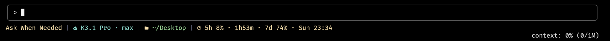

# kimi-code-statusline-bash

[English](README.md) | 中文

为 Windows 上的 [Kimi Code](https://www.kimi.com/code) 提供一条 Claude Code 风格的状态栏。它替换 Kimi Code 底部区域的第一行，显示工作时值得随时瞄一眼的信息：权限模式、模型与思考强度、当前目录、git 分支、套餐额度、会话已进行的时间和改动的行数，以及在两轮对话之间，服务器还会保留提示缓存多久。



在 git 仓库中、会话开始之后，还会显示分支、会话时长和改动行数，以及缓存倒计时：

```text
Ask When Needed | K3 · max | ~/Desktop/proj | main | 5h 5% · 3h41m · 7d 52% · Sat 23:34 | 1h23m +120/-45 | 24m
```

整个状态栏只是一个 bash 脚本，由 Git for Windows 自带的 bash 运行。无需编译，所有代码都可以直接阅读和修改。

> 非官方项目：与月之暗面（Moonshot AI）没有关联，也未获其认可。

## 显示内容

| 部分 | 显示 | 说明 |
|---|---|---|
| 权限模式 | `Always Ask`、`Ask When Needed` 或 `Never Ask`，计划模式下另加 `plan` | 即 Kimi Code 终端界面对这三种模式的称呼（中文界面中为“始终询问”“必要时询问”“完全自动”），依次显示为绿、黄、红：不经询问就执行的操作越多，颜色越醒目。 |
| 模型 | 模型名与思考强度 | 思考强度取自会话日志（即实际生效的那一个）；会话日志中还没有时，取自 `config.toml`。 |
| 目录 | 工作目录 | 用户目录显示为 `~`；较长的路径只保留最后三级。 |
| Git | 当前分支 | 不在 git 仓库中时不显示。 |
| 额度 | Kimi Code 套餐的 5 小时与 7 天用量：5 小时窗口距重置还剩多久，以及 7 天窗口在星期几、几点重置 | 低于 60% 为绿色，低于 85% 为黄色，更高为红色。每 5 分钟在后台刷新一次（窗口重置后也会立即刷新），上次成功刷新已超过 15 分钟时变灰。未使用 Kimi Code 套餐时不显示。 |
| 会话 | 会话开始至今的时间、增加和删除的行数 | 统计执行成功的 Edit 和 Write 工具调用（包括子代理），按逐行比较的差异计数。 |
| 提示缓存 | 两轮对话之间，距服务器丢弃本会话的提示缓存还剩几分钟 | 每次调用模型之后，Kimi Code 的服务器会把对话缓存一段时间。时长取 Kimi Code 自己的估计（它的“缓存已过期”提示也用这个估计），目前 K3 和 K3.1 Pro 为 30 分钟，Kimi for Coding 为 60 分钟。显示为蓝色，最后 5 分钟变黄，之后显示 `cold`：下一条消息需要把整段对话重新读一遍，更慢，也更耗额度。切换到另一个模型后也立即显示 `cold`，因为新模型没有这段对话的缓存。一轮对话进行中时不显示（每次调用模型都会刷新缓存），除非缓存已经过期；Kimi Code 没有估计的模型也不显示。 |

上下文用量不重复显示，因为 Kimi Code 底部的第二行已经显示了。配置了状态栏命令后，Kimi Code 用命令的输出代替自己底部的第一行，所以那一行里的目标和运行中任务的标记（Kimi Code 2.3）不会出现；Kimi Code 不会把它们传给状态栏命令。

## 环境要求

- Windows 10 或 11，并已安装 [Kimi Code](https://www.kimi.com/code)。已在 Kimi Code 2.2.0 上测试。
- [Git for Windows](https://git-scm.com/download/win)（需要其中的 bash 5）：`winget install Git.Git`
- [jq](https://jqlang.org)，用于额度、思考强度、改动行数和缓存倒计时：`winget install jqlang.jq`。没有 jq 时，这几部分保持为空。
- 终端字体设为某种 [Nerd Font](https://www.nerdfonts.com)，图标才能正常显示。

## 安装

在 PowerShell 中运行：

```powershell
irm https://raw.githubusercontent.com/infinitr0us/kimi-code-statusline-bash/main/install.ps1 | iex
```

然后在 Kimi Code 中运行 `/reload-tui`，或重启 Kimi Code。

这会安装最新发布的版本。如需安装指定版本：

```powershell
& ([scriptblock]::Create((irm https://raw.githubusercontent.com/infinitr0us/kimi-code-statusline-bash/main/install.ps1))) -Version v0.1.0
```

也可以从 [Releases](https://github.com/infinitr0us/kimi-code-statusline-bash/releases) 下载 `kimi-code-statusline-bash-<版本>.zip`，解压后先阅读脚本，再在该目录中运行 `powershell -ExecutionPolicy Bypass -File .\install.ps1`。用 zip 安装不需要联网，所以如果访问 raw.githubusercontent.com 或 GitHub 下载不稳定，可以先用任何方式取得 zip，再在本地安装。

### 安装程序会做什么

- 把 `statusline.sh` 和一个小的启动脚本 `statusline.cmd` 放到用户目录下的 `.kimi-code\statusline-bash\`（如果设置了 `KIMI_CODE_HOME`，则放到 `%KIMI_CODE_HOME%\statusline-bash\`）。
- 把 Kimi Code 的 `tui.toml` 中 `[status_line]` 下的 `command` 设为该启动脚本，`tui.toml` 的其余内容保持不变。
- 修改任何文件之前，先把它备份为 `<文件名>.bak-<日期>-<时间>`。
- 找到 Git Bash 和 jq 并记下它们的位置（Git Bash 写在启动脚本中，jq 写在同目录的 `jq-path.txt` 中），因为 Kimi Code 启动的 shell 不一定有你终端里的 PATH。
- 最后实际运行一次状态栏，并显示结果。

如果 `tui.toml` 中已经配置了别的状态栏命令，安装程序会直接停止，不做任何修改。加上 `-Force` 会替换该命令；之后用 `uninstall.ps1` 卸载时，会把它原样恢复。

可用参数：`-Version`、`-KimiHome`、`-GitBash`、`-JqPath`、`-Force`，详见 `Get-Help .\install.ps1 -Detailed`。

## 更新

再运行一次安装命令即可。它会替换 `statusline.sh`（如果你的版本与新版不同，会先备份），其他内容保持不变。

## 卸载

```powershell
irm https://raw.githubusercontent.com/infinitr0us/kimi-code-statusline-bash/main/uninstall.ps1 | iex
```

这会从 `tui.toml` 中删除 `[status_line]` 的命令（或恢复安装前的命令），删除已安装的文件和 `.kimi-code\cache\statusline` 中的缓存，并保留备份。然后运行 `/reload-tui`。

## 自定义

编辑用户目录下的 `.kimi-code\statusline-bash\statusline.sh`。Kimi Code 每次都会重新运行这个文件，所以改动一秒内就能看到效果。各部分在文件末尾附近按显示顺序拼接，颜色是普通的 ANSI 代码（`92` 绿、`93` 黄、`91` 红等）。这部分要保持快速：Kimi Code 会丢弃运行超过 300 毫秒的结果（见[工作原理](#工作原理)）。

更新会覆盖你的修改，但安装程序会把你的版本保留为 `statusline.sh.bak-<日期>-<时间>`。

如需使用另一个 jq，可以带 `-JqPath` 重新运行安装程序，或把环境变量 `KIMI_STATUSLINE_JQ` 设为它的路径。

## 工作原理

Kimi Code 大约每秒运行一次 `[status_line]` 中的命令，通过 stdin 传入一份 JSON 快照（模型、目录、分支、权限模式、会话 ID 等），并显示命令输出的第一行。超过 300 毫秒仍未结束的运行会被终止并忽略。在 Windows 上，这条命令经由 `cmd.exe` 执行，所以安装程序让它指向 `statusline.cmd`，再由后者用 Git Bash 运行 `statusline.sh`。

在 Git Bash 中，每启动一个程序都要花几十毫秒，因此渲染过程只用 bash 内建命令，大约 50 毫秒完成。耗时的工作放在后台进程中进行，结果写入 `.kimi-code\cache\statusline`，供之后的渲染读取：

- 每 5 分钟从 Kimi Code 的用量接口获取一次额度（curl 和 jq），并每天获取一次 Kimi Code 自己使用的提示缓存时长；
- 会话日志有新内容时，读取新增的记录，统计改动行数、思考强度、最近一次调用模型的时间，以及是否有一轮对话正在进行（jq）。空闲的会话不产生任何开销。

## 隐私与安全

- 为获取额度，脚本会读取 Kimi Code 保存在 `.kimi-code\credentials\` 中的登录令牌（或 `config.toml` 中的 API key），并且只发送给 Kimi Code 服务商自己的 `base_url`（默认为 `https://api.kimi.com/coding/v1/usages`）。令牌通过 stdin 传给 curl，不会出现在进程列表中。脚本从不刷新或改写你的凭据；令牌过期时，它会等 Kimi Code 自己刷新。
- 提示缓存时长来自同一服务器（`<base_url>/client_configs`，一项公开设置），获取时不带令牌。获取失败时，脚本读取 Kimi Code 自己保存在 `.kimi-code\cache\client-configs\` 中的副本。
- 会话日志只在本地读取，用于统计改动行数和计算缓存倒计时。除此之外，没有任何数据离开你的电脑。
- 除了一次临时下载，安装程序只在 Kimi Code 的主目录中写入文件。

## 故障排查

**Kimi Code 仍显示它自己的状态栏。** 先运行 `/reload-tui`。如果没有用，说明命令运行失败或超过了 300 毫秒。可以手动运行试试（PowerShell 输出中的图标可能显示为乱码）：

```powershell
Measure-Command { '{"model":"K3","permissionMode":"yolo"}' | & "$HOME\.kimi-code\statusline-bash\statusline.cmd" | Out-Host }
```

**图标显示为方框或问号。** 把终端字体设为某种 Nerd Font。

**额度显示 `…`、`?` 或变灰。** `…` 表示第一次获取尚未完成。`?` 或灰色表示获取失败：请确认已用带 Kimi Code 套餐的账号登录 Kimi Code，并已安装 jq。如果令牌是在 Kimi Code 闲置期间过期的，下次 Kimi Code 与服务器通信时会自动刷新。

**没有思考强度或改动行数。** 缺少 jq。安装它（`winget install jqlang.jq`）后重新运行安装程序。

**没有缓存倒计时。** 它在会话调用过一次模型之后、两轮对话之间显示，只针对 Kimi Code 套餐的模型，并且需要 jq。一轮对话结束后，可能要过一两秒才出现。

**Kimi Code 更新后某部分显示不对。** 脚本读取的文件和接口（会话日志、用量接口）都没有公开文档，Kimi Code 更新时可能会改变它们。请[提交 issue](https://github.com/infinitr0us/kimi-code-statusline-bash/issues)，并注明你的 Kimi Code 版本（`kimi --version`）。

## 开发

`tests\run-tests.ps1` 会在 `%TEMP%` 下创建临时的 Kimi 主目录并安装，按 Kimi Code 的方式渲染状态栏（使用虚构的会话和一个模拟的用量接口，需要 Python），然后卸载。它不会改动你自己的 Kimi 主目录。CI 会分别用 PowerShell 7 和 Windows PowerShell 5.1 运行它。

发布新版本时，在 `CHANGELOG.md` 中添加 `## [x.y.z] - <日期>` 一节，然后推送标签 `vx.y.z`。发布工作流会运行测试，用 `tools\build-release.ps1` 构建发布文件并发布。

## 许可证

[MIT](LICENSE)
